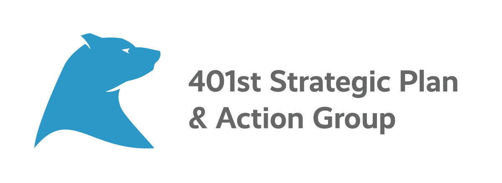

  

# 401SPAG

**Strategy into action.**

401SPAG is a boutique strategy consulting firm based in Pangyo, South Korea. We work with deep tech organizations on strategic planning, market entry, and technology adoption.

This GitHub organization brings together our public research and practical frameworks for traceable software changes, AI agent execution, and evidence management.

## Featured research

**[TRACE Gate Framework](https://github.com/401SPAG/trace-gate-framework)** connects requests, execution boundaries, verification evidence, and gate decisions throughout software and AI workflows.

| Component | Focus |
| --- | --- |
| [TRACE Core](https://github.com/401SPAG/trace-gate-framework/blob/main/docs/TRACE-GATE-FRAMEWORK.ko.md) | Trace, Restrict, Assemble, Confirm, Elevate |
| [TRACE-DM](https://github.com/401SPAG/trace-gate-framework/blob/main/docs/subframeworks/TRACE-DOCUMENT-MANAGEMENT.ko.md) | Document identity, revision history, provenance, freshness, and purpose-based access |
| [TRACE-AH](https://github.com/401SPAG/trace-gate-framework/blob/main/docs/subframeworks/TRACE-AGENT-HARNESS.ko.md) | Agent execution boundaries, tool contracts, checkpoints, and verification |

Start with the [documentation and reference implementation](https://github.com/401SPAG/trace-gate-framework#문서). Research claims and implementation scope are described in the project documentation.

## Participate

For project questions and suggestions, use [repository issues](https://github.com/401SPAG/trace-gate-framework/issues). For contributions, read the [contributing guide](https://github.com/401SPAG/trace-gate-framework/blob/main/CONTRIBUTING.md). TRACE-GATE documentation uses CC BY-NC-ND 4.0. Its code has separate noncommercial terms restricting distribution of modified versions, with a limited official contribution exception. See the [licensing scope and preserved prior permissions](https://github.com/401SPAG/trace-gate-framework/blob/main/LICENSING.md) before reuse.

For research collaboration or business inquiries, contact **[mail@401spag.com](mailto:mail@401spag.com)**.

[Website](https://401spag.com) · Pangyo, South Korea

---

401SPAG는 딥테크 기업의 전략 수립, 시장 진입과 기술 도입을 지원합니다. 이곳에서는 소프트웨어 변경과 AI 에이전트 실행의 추적성·검증·증거 관리를 위한 연구 및 프레임워크를 공유합니다.

Profile text is provided under [CC BY-NC-ND 4.0](https://github.com/401SPAG/.github/blob/main/LICENSE). Logos and brand artwork are covered separately by the [brand notice](https://github.com/401SPAG/.github/blob/main/BRAND-NOTICE.md).
